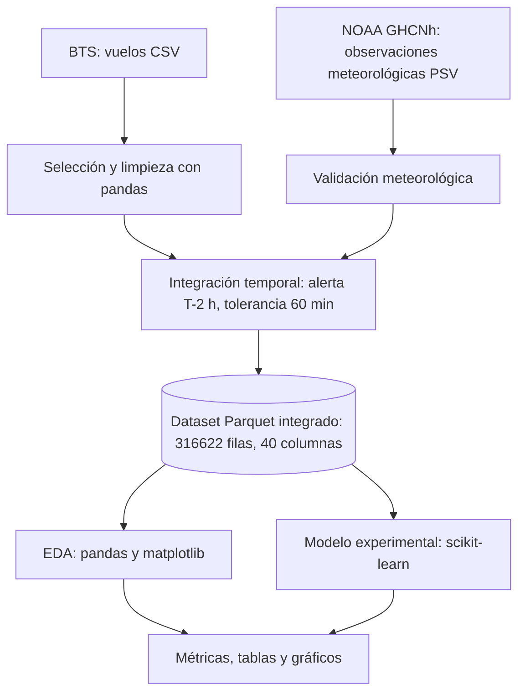

# Arquitectura del prototipo de alerta temprana de demoras

## 1. Diagrama de arquitectura

## 2. Componentes implementados

| Componente | Tecnología |
|---|---|
| Fuente de vuelos | BTS, CSV dentro de ZIP |
| Fuente meteorológica | NOAA GHCNh, archivos PSV |
| Procesamiento e integración | Python y pandas |
| Almacenamiento integrado | Parquet |
| Muestra para inspección | CSV de 5000 filas |
| Análisis exploratorio | pandas y matplotlib |
| Modelo experimental | scikit-learn |
| Entorno | macOS local |

## 3. Flujo de procesamiento

1. Leer los archivos BTS y seleccionar los nueve aeropuertos.
2. Excluir vuelos cancelados y desviados.
3. Leer y validar las observaciones meteorológicas NOAA.
4. Normalizar campos y eliminar duplicados meteorológicos.
5. Calcular el instante de alerta dos horas antes de la salida programada.
6. Asociar la observación más reciente disponible hasta ese instante, con tolerancia máxima de 60 minutos.
7. Guardar el dataset integrado en Parquet y una muestra de 5000 filas en CSV.
8. Realizar análisis exploratorio y evaluar el modelo.
9. Guardar las métricas y los gráficos generados.

## 4. Limitaciones

- La ejecución es local; no es un sistema distribuido en producción.
- El pipeline utiliza pandas y scikit-learn, no Spark.
- El 99.82% de coincidencia temporal meteorológica no significa que todas las variables estén completas.
- Los datos representan vuelos de Estados Unidos, no operaciones reales de LATAM Airlines.
- El modelo es experimental y no está listo para producción.